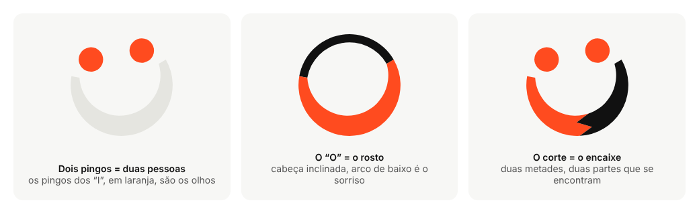
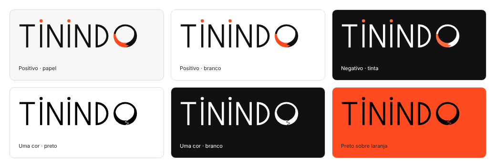
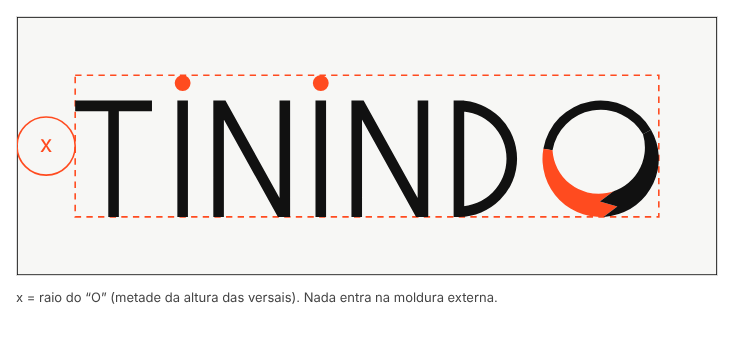
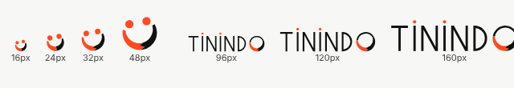
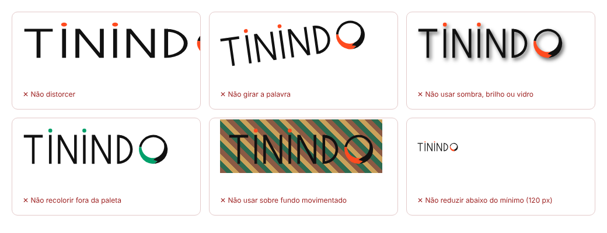
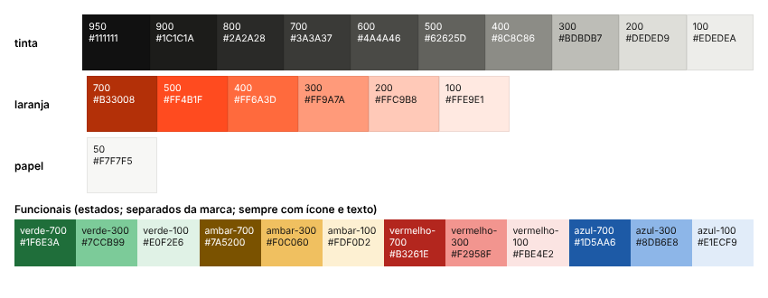
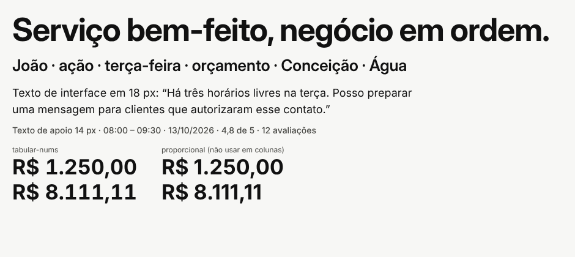

# Tinindo — Manual de marca

**Versão 0.2 · 11 de outubro de 2026 · identidade “sorriso” (proposta do fundador, refinada nesta sessão)**
Estado: proposta para aprovação do fundador e do sócio. Não é identidade registrada nem juridicamente liberada.

Rótulos: **confirmado** (decisão do fundador), **hipótese**, **proposta**, **pendente de validação**.

---

## 1. Como usar este manual

Permite que outra pessoa (ou ferramenta) aplique a marca sem depender da conversa que a originou. Regras para agentes de código: `BRAND.md`. Valores de cor, tipo e espaçamento: `tokens/tokens.json` e `tokens/tokens.css` (a fonte é o token, não este texto).

Existe: logotipos vetoriais, ícones, tokens, vitrine HTML navegável, peças de aplicação, apresentação para o sócio.
Não existe: pesquisa de mercado verificada, validação com profissionais, parecer jurídico, produto em operação.

## 2. Plataforma de marca

### 2.1 Propósito e problema (hipótese, a validar)
Quem presta serviço sozinho acumula execução, atendimento, vendas, agenda, cobrança e compras; o trabalho em si costuma ser o que a pessoa quer fazer. **Propósito proposto:** dar a quem trabalha com as mãos e com a cabeça a capacidade administrativa de uma equipe pequena, e dar a quem contrata um jeito claro de escolher. O profissional faz o serviço; a Tinindo ajuda a fazer o negócio funcionar.

### 2.2 Posicionamento (proposta)
- **Para:** profissionais autônomos de serviços e as pessoas que os contratam.
- **Categoria:** gestão do trabalho com descoberta e reputação.
- **Benefício principal:** negócio organizado e profissional encontrável, sem aprender cinco sistemas.
- **Fundamento:** dados estruturados, cálculos determinísticos e um assistente que consulta dados reais e pede aprovação antes de agir. *Em desenvolvimento; hoje existe apenas a demonstração visual.*

### 2.3 Promessa e limites
**Promessa (proposta):** menos tempo no administrativo, mais clareza sobre o negócio, perfis em que cada informação tem significado explícito.
**Limites:** não promete agenda cheia, aumento de renda, qualidade garantida, habilitação profissional nem verificação de antecedentes. Um selo bonito não prova nada disso.

### 2.4 Personalidade → decisões visuais e verbais
| Atributo | Visual | Verbal |
|---|---|---|
| Competência acessível | Hierarquia clara; preto firme; poucos elementos por tela | Frases curtas, termos do ofício, sem jargão de tecnologia |
| Proximidade sem infantilização | Sorriso no símbolo, mas em linhas finas e preto adulto; sem mascote | Tratamento por “você”, sem gíria forçada nem diminutivos |
| Tecnologia sofisticada, uso simples | Material “vidro” só em camadas flutuantes; movimento contido | Explica o que o assistente fez e pede aprovação |
| Trabalho bem-feito e organização | Alinhamento rigoroso, escala de 4 px, letras finas e precisas | “Em ordem”, “bem-feito”, números com contexto |
| Orgulho profissional e autonomia | Retratos dignos; o profissional é o protagonista | O profissional decide; a Tinindo ajuda |

### 2.5 Mensagens por público
- **Profissional:** “Organize o negócio. Continue no seu ofício.”
- **Contratante:** “Encontre um profissional.” Veja o que faz, onde atende e quando tem horário; identidade, avaliações e formação aparecem separadas.
- **Comunidade/condomínio (hipótese):** indicação organizada, sem spam e sem sugerir aval da administração.

### 2.6 Descrições
**Uma frase:** A Tinindo ajuda quem presta serviço a organizar o negócio e a ser encontrado, e ajuda quem contrata a escolher com clareza.

**Até 80 palavras (68):** A Tinindo reúne, em um só lugar, a gestão do trabalho de quem presta serviço e a descoberta de profissionais por quem contrata. Agenda, clientes e orçamentos ficam organizados; um assistente consulta os dados e prepara tarefas, e você aprova antes de qualquer envio. Para quem contrata, os perfis mostram o que cada profissional faz, onde atende e quando tem horário, com identidade, avaliações e formação sempre separadas.

### 2.7 Assinatura verbal (proposta; nenhuma aprovada)
1. **Serviço bem-feito, negócio em ordem.** ← recomendação provisória
2. Seu trabalho bem-feito. Seu negócio em dia.
3. Você faz o serviço. A Tinindo ajuda no resto.
4. Trabalho bem-feito merece ser encontrado.
5. Gente que faz bem-feito, gente que se encontra.

*Por que a 1:* ecoa o sentido de “tinindo” (bem executado) para os dois lados; promete organização, não resultado financeiro; ritmo de duas metades. A 5 conversa mais com o símbolo (encontro), mas é mais abstrata. *Riscos:* “negócio” pode soar pesado para quem se vê como profissional, não empresa (testar). **Pendente de validação com o público.**

### 2.8 Vocabulário
**Preferir:** profissional, serviço, atendimento, agenda, orçamento, cliente, bem-feito, combinar, aprovar, “você decide”, “nada é enviado sem a sua aprovação”.
**Evitar:** ecossistema, agentic, omnichannel, revolucione, turbine, garantido, “melhor profissional”, “mão de obra”, “bico”, “jeitinho”, “IA mágica”, “selo de qualidade” sem política, “Tinindo garante”.

### 2.9 Arquitetura de marca
Marca única **Tinindo**; descritores de função (“Para profissionais”, “Encontre um profissional”) em vez de submarcas. Sem Tinindo Pro, Academy ou Pay antes de o serviço existir.

---

## 3. Logotipo

### 3.1 O conceito: gente que se encontra, com um sorriso
Três ideias, todas já visíveis na palavra:

1. **Dois pingos = duas pessoas.** Os pingos dos dois “I” de TININDO são laranja e funcionam como os olhos de um rosto: o profissional e quem contrata.
2. **O “O” = o rosto, com um sorriso.** O “O” da palavra é um círculo inclinado 10°; a metade de cima é preta e o arco de baixo (um sorriso largo de 220°, mais grosso no meio) é colorido.
3. **O corte = o encaixe.** O sorriso é dividido ao meio em dentes de serra: metade laranja, metade preta. Lido sozinho, o sorriso sem anel também lembra duas pessoas se encontrando; o corte reforça a ideia de duas partes que se encaixam, o que casa com o marketplace.

Escolhas de linguagem: letras finas e largas (precisão, “nobreza”), preto como cor-base (adulto, firme), laranja como destaque vivo (energia, “cor forte”). O sorriso dá proximidade sem usar mascote.

**O “O” da palavra é exatamente o mesmo desenho do símbolo** (mesma geometria, só escalado e sem os olhos, que na palavra são os pingos dos “I”). Nunca redesenhar nem endireitar o “O”.

As letras foram desenhadas como formas geométricas vetoriais, geradas por script (`assets/logo/source/`). **O wordmark não é uma fonte**: só existem T, I, N, D e O; não componha outras palavras com ele.

### 3.2 Arquivos mestres (`assets/logo/`)
| Uso | SVG | PNG |
|---|---|---|
| Wordmark positivo | `tinindo-wordmark-color.svg` | 1200 px, transparente |
| Wordmark negativo (fundo escuro) | `tinindo-wordmark-negativo-cor.svg` | idem |
| Wordmark uma cor | `tinindo-wordmark-preto.svg`, `…-branco.svg` (divisão do sorriso vira fresta) | idem |
| Símbolo principal (sem anel) | `tinindo-symbol-{color,negativo-cor,preto,branco}.svg` | 512 px |
| Símbolo com anel (uso grande) | `tinindo-symbol-anel-{color,negativo-cor}.svg` | 512 px |
| Símbolo pequeno, variante óptica (≤ 24 px) | `tinindo-symbol-pequeno-optico-{color,negativo-cor,preto,branco}.svg` | 256 px |

Os SVG são formas preenchidas (sem texto, raster ou script). O corte do sorriso usa `clipPath` (vetor real). **Limitação:** o corte não está unido em um contorno único; antes de gráfica, bordado ou corte de vinil, unir as formas em editor vetorial (ver STATUS.md).

### 3.3 Uma cor: a fresta
Em preto ou branco puro não há duas cores para separar as metades; por isso o corte vira uma fresta fina. Em tamanhos pequenos a fresta é a primeira coisa que some: nesse caso usar a variante óptica (corte reto, olhos e sorriso maiores).

### 3.4 Área de proteção
**x** = raio do “O” (metade da altura das versais), em todos os lados.

### 3.5 Tamanhos mínimos (medidos em pixels reais, Chromium 1×)

| Elemento | Mínimo | Base |
|---|---|---|
| Símbolo (variante óptica) | **16 px** | Rosto e sorriso reconhecíveis; olhos pequenos |
| Símbolo (versão padrão) | 32 px | A partir de 24 px a variante óptica é opcional |
| Wordmark em tela | **120 px de largura** | A 96 px o sorriso do “O” e o corte quase somem; a 120 px o “O” e o corte ainda se leem |
| Wordmark impresso | 32 mm de largura | Conversão de 120 px a 96 dpi (hipótese; não testado em gráfica) |
| Bordado, duas cores (símbolo / wordmark) | 30 mm / 60 mm | **Hipótese**, não testada em bordadeira; exige dois fios; pedir prova |

O traço fino das letras é o ponto mais sensível: **não use o wordmark abaixo de 120 px**; nesses casos use o símbolo.

### 3.6 Ícone de app, favicon e avatar
- `assets/app-icons/app-icon-1024.svg|png` (fundo preto, quadrado cheio; a plataforma aplica a máscara) e 512, 192, 180. O símbolo (sem anel, inclinado) ocupa 58% do lado. `app-icon-rounded-preview.*` é só pré-visualização.
- Avatar de WhatsApp: `avatar-whatsapp-claro|escuro` (640 px). O símbolo ocupa 50% do lado para sobrar margem no recorte circular.
- Favicon: `assets/icons/favicon.svg` (variante óptica; o lado direito do sorriso troca de preto para branco conforme o tema do navegador) e PNG 16/32/48. **`favicon.ico` não foi gerado.**

### 3.7 Uso incorreto

Também não: aplicar vidro, desfoque ou gradiente ao logotipo; recriar o logotipo com texto digitado ou emoji; inverter as cores das metades do sorriso; trocar o laranja; usar o símbolo como emoji em texto corrido; usar “Tinindo” em fonte genérica no lugar do wordmark.

---

## 4. Cor

### 4.1 Paleta
| Papel | Nome | HEX | RGB | CMYK aprox.* |
|---|---|---|---|---|
| Base da marca, texto, ações | Tinta 950 | `#111111` | 17, 17, 17 | 0/0/0/93 |
| Destaque vivo (pingos, olhos, sorriso, linhas) | Laranja 500 | `#FF4B1F` | 255, 75, 31 | 0/71/88/0 |
| Destaque no escuro | Laranja 400 | `#FF6A3D` | 255, 106, 61 | 0/58/76/0 |
| Texto em destaque | Laranja 700 | `#B33008` | 179, 48, 8 | 0/73/96/30 |
| Fundo claro | Papel 50 | `#F7F7F5` | 247, 247, 245 | 0/0/1/3 |
| Fundo escuro | Tinta 950 / 900 | `#111111` / `#1C1C1A` | | |

\* CMYK calculado por fórmula simples; é **aproximação** (depende do perfil de impressão e do papel). O laranja vivo é difícil de reproduzir em CMYK: pedir prova. **Sem equivalência Pantone.**

### 4.2 Regras de uso
- **Preto é a marca; laranja é o destaque.** Proporção sugerida: ~70% papel/tinta, ~25% neutros, ≤5% laranja.
- **A ação principal da interface é preta** (botão preto com texto branco; branco com texto preto no escuro). O laranja **não** é cor de botão nem de estado, para não se confundir com erro (vermelho) ou atenção (âmbar).
- **Laranja nunca é cor de texto corrido.** `laranja-500` como texto sobre papel dá 3,12:1 (proibido). Texto em destaque usa `laranja-700`.
- Sorriso em laranja claro ou cinza claro foi testado e **rejeitado** (1,8:1 a 2,0:1; some no fundo claro).
- Cores funcionais (sucesso, atenção, erro, informação) são separadas da marca. Estado, avaliação ou disponibilidade nunca só por cor: sempre ícone e texto. **Risco aceito:** o âmbar de atenção e o vermelho de erro ficam próximos do laranja da marca; por isso a marca usa laranja só decorativamente e os estados sempre vêm com ícone e rótulo.

### 4.3 Contraste
Os 36 pares semânticos (claro e escuro) foram calculados por script a partir dos tokens; **todos passam** (4,5:1 texto, 3:1 componentes). Relatório: `tokens/contrast-report.md`.

| Par | Razão |
|---|---|
| Wordmark preto sobre papel | 17,6:1 |
| Preto sobre laranja-500 (fundo laranja com logo preto) | 5,65:1 |
| Laranja-400 sobre tinta (negativo) | 6,64:1 |
| Laranja-500 como ponto/olho sobre papel (não textual) | 3,12:1 |
| **Laranja-500 como texto sobre papel** | **3,12:1, proibido** |
| Branco sobre laranja-500 | 3,34:1, só elementos grandes |

Isto verifica cores; não garante a conformidade da interface inteira (§8).

---

## 5. Tipografia

**Wordmark:** lettering próprio (§3). **Interface e texto:** Inter e Inter Display (OFL 1.1, verificada no pacote local `fonts-inter` 4.0; licença em LICENSES.md). Uma família variável, um arquivo.

| Token | Valor |
|---|---|
| Pesos | 400 texto · 500 rótulos · 600 botões e títulos médios · 700 só títulos grandes |
| Tamanhos | 12 · 14 · 16 · 18 · 20 · 24 · 32 · 44 · 56 px |
| Altura de linha | títulos 1,1 · interface 1,25 · texto 1,5 |
| Espaçamento de letras | títulos −0,02 em; rótulos em caixa-alta +0,06 em (ecoa as versais do wordmark) |
| Fallback | `system-ui, "Segoe UI", Roboto, "Helvetica Neue", Arial, sans-serif` |
| Números em agenda, preços e indicadores | `font-variant-numeric: tabular-nums` |

Verificado: “ação”, “João”, “terça-feira”, “Conceição”, “Água”, “R$ 1.250,00”. Nenhuma fonte proprietária da Apple é usada.

---

## 6. Iconografia e fotografia

**Ícones de interface** (`assets/icons/ui-icons-sprite.svg`, 12 ícones): grade 24 px, traço 2 px, pontas arredondadas, `currentColor`. Evitar: robô, cérebro, circuito, ferramenta cruzada, faísca de “IA”, aperto de mão literal, pin de mapa como símbolo de marca. A estrela de avaliação sempre vem com número.
**O sorriso é exclusivo do logotipo:** não usar rostos sorridentes/emoji como decoração da interface; isso diluiria o símbolo.

**Fotografia (proposta; nenhuma foto produzida):** documental, luz natural, mãos e contexto reais de trabalho; profissionais com dignidade, competência e diversidade realista, executando o serviço de forma correta; foco no resultado; sempre com consentimento. Evitar sorrisos de banco de imagem (competem com o sorriso da marca), “antes e depois” exagerado e imagens geradas por IA apresentadas como pessoas reais.

---

## 7. Sistema visual do produto

### 7.1 Princípios
Hierarquia clara, poucos elementos, ação principal evidente, leitura ao ar livre no celular. Tema claro é o padrão; escuro é suportado.

### 7.2 Material “vidro” (tradução de cristal líquido)
**Somente** em camadas flutuantes (barra de navegação, sheets, diálogo do agente). Nunca em tabelas, campos, formulários, texto corrido nem no logotipo. `.tn-glass` em `tokens.css`: alternativa opaca por padrão; desfoque só se suportado; opaco em `prefers-reduced-transparency` e `prefers-contrast: more`. Movimento zerado em `prefers-reduced-motion`.

### 7.3 Componentes (todos em `applications/preview.html`)
Botões e links (normal, hover, foco, pressionado, desabilitado, carregando); campos com erro; cartão de profissional; agenda (confirmado, aguardando, cancelado, bloqueado, livre); indicador financeiro com período; blocos de reputação; avisos, vazio e erro; diálogo de aprovação do agente; navegação responsiva. Alvo de toque de 44 px (**recomendação**; o mínimo normativo do WCAG 2.2, critério 2.5.8, é 24×24 px).

### 7.4 Agente: cinco estados
| Estado | Rótulo | Regra |
|---|---|---|
| Informação consultada | “Informação consultada” | Diz de onde veio o dado |
| Recomendação | “Recomendação” | Não executa nada |
| Ação pendente de aprovação | “Ação pendente de aprovação” | Mostra destinatários, texto, benefício/desconto, custo estimado e horário |
| Ação executada | “Ação executada” | No protótipo: “(simulada)” e “nenhuma mensagem foi enviada” |
| Falha | “Falha” | Diz o que não aconteceu e oferece alternativa |

Nunca “Mensagem enviada” em simulação. Não imitar a interface oficial do WhatsApp.

### 7.5 Reputação e selos
**Identidade verificada, avaliação de cliente, serviço realizado pela plataforma e formação/certificação são quatro coisas diferentes; nenhuma implica as outras.** “Patrocinado” sempre explícito (“a posição não indica melhor avaliação”). Perfil sem avaliações: “Perfil novo · ainda sem avaliações”. Não existe selo “Tinindo garante”.

---

## 8. Acessibilidade

Referência: **WCAG 2.2 AA**. *Critérios citados de memória; a fonte oficial (w3.org/TR/WCAG22) não pôde ser consultada (rede bloqueada). Confirmar antes de declarar conformidade.*
- Contraste (1.4.3, 1.4.11): **medido nos tokens**.
- Foco visível e não obscurecido (2.4.7, 2.4.11): anel de 3 px; **implementado na vitrine, sem teste manual de teclado ou leitor de tela**.
- Estado nunca só por cor (1.4.1): **implementado**.
- Redução de movimento e transparência: **implementado** em `tokens.css`.
- O logotipo é tratado à parte no padrão, mas sua legibilidade continua sendo requisito (§3.5).

**Sem declaração de conformidade.** Pendente: auditoria manual (teclado, leitor de tela, zoom 200%, formulários).

---

## 9. Tom de voz

Português brasileiro claro, adulto, próximo e respeitoso. Sem gíria forçada, “jeitinho”, linguagem corporativa vazia ou promessa exagerada. O sorriso do logotipo não autoriza tom infantil.

| Situação | Usar | Evitar | Por quê |
|---|---|---|---|
| Apresentação ao profissional | “Organize o negócio. Continue no seu ofício.” | “Revolucione seu negócio com IA!” | Respeita o ofício; sem promessa inflada |
| Apresentação a quem contrata | “Veja o que cada profissional faz, onde atende e quando tem horário.” | “Os melhores profissionais, garantidos.” | Descreve; não garante o que não opera |
| Convite a organizar a agenda | “Quer colocar a semana em ordem? Comece pelos horários de terça.” | “Você está perdendo clientes por desorganização.” | Convite, não acusação |
| Solicitação de avaliação | “Como foi o serviço com Marcos? Sua opinião ajuda o próximo cliente.” | “Dê 5 estrelas!” | Pede opinião honesta, não nota |
| Lembrete de atendimento | “Amanhã, 08:00: instalação de chuveiro com Ana C.” | “Não esqueça!!!” | Informação objetiva |
| Proposta do agente | “Há três horários livres na terça. Posso preparar uma mensagem para clientes que autorizaram esse contato. Você revisa antes do envio.” | “Já mandei mensagem para todo mundo.” | Pede aprovação; respeita consentimento |
| Erro de integração | “Não foi possível conectar. Nada foi enviado. Você pode copiar o texto ou tentar de novo.” | “Ops! Algo deu errado.” | Diz o que aconteceu e o que fazer |
| Atendimento cancelado | “Ana C. cancelou o atendimento das 16:00. O horário voltou a ficar livre.” | “Você perdeu um cliente.” | Neutro; indica o próximo passo |
| Perfil sem avaliações | “Perfil novo · ainda sem avaliações. Veja os trabalhos e peça um orçamento.” | “Sem avaliações: contrate por sua conta e risco.” | Todo profissional começa sem avaliações |

---

## 10. Aplicações

Todas com dados fictícios e rotulados.
- `applications/preview.html`: site (dois públicos), agenda, perfil público, agente, estados; responsivo; claro/escuro.
- `applications/pieces.html`: cartão de indicação (frente e verso), uniforme, cartaz de condomínio (declara que não é comunicado do condomínio), avatar.
- `applications/exports/pecas.png` e `apresentacao/Tinindo-apresentacao-socio.pptx`.

## 11. De onde viemos: três territórios e o caminho até o sorriso

Detalhes em `research/creative-territories.md` e `research/evaluation.md`.

| Etapa | O que aconteceu |
|---|---|
| Território A, “Tudo em ordem” | T de blocos de agenda; descartado (parece software genérico, some pequeno) |
| Território B, “Indicação” | Arco com ponto; boa nota na matriz (7,80) e primeiro kit completo (arquivado em `research/territories/b-indicacao/kit-completo-anterior/`) |
| Território C, “Capricho” | Versais finas e nobres; gostou da letra, não do símbolo (anel excêntrico) |
| Território D/E | Versais finas do C + pingos laranja do A e B; cor forte testada; preto como base |
| Símbolo | Cinco ideias (i, ii, T-teto, N, anel+ponto) → mistura de “ii” e “anel” → **sorriso**, ideia do fundador |
| Refino | Sorriso de 220°, mais grosso no meio; cabeça inclinada 10°; “O” da palavra igual ao símbolo; corte em dentes de serra em duas cores |

**Avaliação do território escolhido** (mesma matriz, julgamento de design): **6,85**, contra 7,80 do B. A queda vem de distinção (5, motivo de rosto sorrindo é comum; pesquisa pendente) e de legibilidade/reprodução (6, traço fino e duas cores). Memorização (9) é a maior nota. A escolha é do fundador e do sócio; os riscos são tratáveis com variantes ópticas e regras de uso, e estão listados abaixo.

## 12. Pendências e riscos que afetam o uso da marca
1. **Diligência jurídica de “Tinindo”** (INPI; 3M Company aparece como titular de registros exatos nas classes 03 e 21, segundo consulta de 02/10/2026 relatada, **não reverificada**). Comprar o domínio não libera o uso da marca. Nenhum parecer foi obtido.
2. **Semelhança visual com a linha Tinindo da 3M e com marcas que usam sorriso** não pôde ser checada (sem rede). O preto e o laranja foram escolhidos sem ter visto aquela embalagem.
3. **Pesquisa de referências:** pendente (`research/references.md`).
4. **Risco de leitura “infantil” ou de emoji:** mitigado por letras finas, preto adulto e proibição de sorrisos decorativos; **não testado com pessoas**.
5. **Traço fino:** wordmark só a partir de 120 px; abaixo disso, símbolo.
6. **Duas cores e corte:** reprodução em bordado, serigrafia e impressão precisa de prova; unir o corte em contorno único antes de produzir.
7. Fotografia, fontes além de Inter, auditoria de acessibilidade e `favicon.ico`: pendentes.
