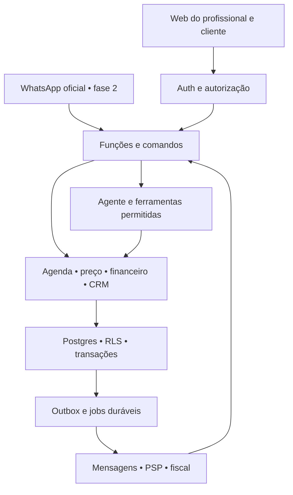

# 01 · Arquitetura de referência

## Decisão de stack

**React + TypeScript + Vite, Supabase Auth/Postgres/Storage/Edge Functions, jobs duráveis em Postgres e CI no GitHub.** Usar um repositório de aplicação e um único lockfile. Preservar a landing page atual em seu deployment enquanto o app ganha vida em subdomínio próprio, salvo descoberta de monorepo já consolidado. Não mover DNS nem substituir `/cliente/` sem plano de migração.

P00 fixa versões estáveis suportadas pelas ferramentas, runtime e gerenciador de pacotes. Se o projeto Lovable existente usar outra estrutura compatível, adaptar este desenho a ele. Não escolher números de versões pelo nome de um modelo. Claude Code/Opus/Codex são ferramentas de desenvolvimento; o produto deve trocar de provedor LLM sem reescrever os módulos.

| Opção | Pontos favoráveis | Custo/risco para este caso | Decisão |
|---|---|---|---|
| Supabase/Postgres | Transações SQL, relações, constraints, RLS, Auth e ambiente local | RLS e funções privilegiadas exigem testes; limites por projeto | Recomendada |
| Firebase/Firestore | SDKs móveis, realtime e transações | Disponibilidade, relatórios e relações pedem modelagem/denormalização mais cuidadosa | Viável, sem vantagem decisiva no piloto |
| Firebase SQL Connect | Opção relacional sobre Postgres no ecossistema Google | Outra superfície de operação e contratos a validar | Alternativa se já dominada |
| Postgres + backend próprio | Controle e portabilidade | Mais autenticação, deploy e infraestrutura por manter | Reavaliar quando necessário |

Firestore não é incapaz de garantir consistência: tem transações. A escolha é de ajuste ao domínio e velocidade da equipe. Firebase não é apenas Firestore; a documentação atual também inclui SQL Connect. Fontes em `13_DECISOES_E_FONTES.md`.

## Topologia

Esse desenho separa responsabilidades, não exige um serviço/processo independente para cada caixa. O banco é o registro oficial. O frontend não calcula preço oficial, saldo, permissão ou reserva final. O LLM não acessa tabelas diretamente.

## Organização proposta

| Caminho | Responsabilidade |
|---|---|
| `src/app/` | Rotas, providers, navegação, tratamento global de erro |
| `src/components/ui/` | Componentes visuais reutilizáveis e acessibilidade |
| `src/features/{identity,crm,scheduling,pricing,waitlist,finance,agent,network}/` | Telas e hooks privados de cada módulo |
| `src/lib/api/` | Cliente tipado; tratamento de autenticação, erros, idempotência |
| `supabase/functions/_shared/contracts/` | DTOs e validação comuns, sem segredos nem dependência Deno |
| `supabase/functions/_shared/domain/` | Regras puras reutilizáveis, sem acesso à rede |
| `supabase/functions/<module>/` | Entradas HTTP, autorização e adaptação para RPC transacional |
| `supabase/migrations/` | Sequência única de migrações, sob coordenação do integrador |
| `db/proposals/Pxx/` | Propostas SQL/testes dos módulos antes de integração |
| `supabase/tests/` | Constraints, funções transacionais, grants e RLS |
| `tests/e2e/`, `tests/contracts/` | Fluxos reais e compatibilidade |
| `docs/adr/`, `docs/handoffs/` | Decisões e contexto durável |

O compartilhamento entre Node/Vite e Deno é restrito a TypeScript puro com imports explícitos e dependências compatíveis. P00 valida isso com um build frontend e `deno check` das funções. Se o bundler exigir geração de DTOs, gerar de uma fonte única; não manter dois contratos à mão.

## Fronteiras de módulos

- Identidade conhece usuários, negócios, membros e contexto ativo.
- CRM possui contatos privados do negócio. Rede possui perfis públicos e avaliações. Não são a mesma tabela.
- Agenda é a única autoridade para ocupar/liberar capacidade.
- Pricing produz cotações versionadas; não altera preço de reserva confirmada.
- Waitlist solicita holds à agenda; não escreve diretamente em `bookings`.
- Financeiro recebe eventos de atendimento e registros de pagamento; não assume que agendar significa receber.
- Agente chama os mesmos comandos que a interface visual.
- Integrações traduzem formatos externos e não concentram regra de domínio.

Leituras simples podem usar Supabase Data API com RLS e projeções explícitas. Escritas críticas passam por comandos/RPC atômica. Uma função Edge fazer três chamadas REST ao banco não torna essas três chamadas uma transação.

## Estratégia de deploy

Três mundos separados: desenvolvimento local com dados sintéticos; homologação com projeto Supabase próprio; produção/piloto real com outro projeto. O preview do Lovable aponta apenas para homologação. O site comercial pode continuar onde está. O app de produção deve ter build reprodutível a partir de uma tag/commit aprovado, em hosting compatível escolhido no P00.

No piloto, publicar frontend estático e funções Supabase. Não introduzir Kubernetes, Kafka, Redis ou microsserviços por causa de “50 usuários”. É volume de dados, concorrência e trabalho por evento que dimensionam a arquitetura.

## Jobs e eventos

Em cada transação relevante, gravar dados e uma linha em `outbox_events`. Um dispatcher leva o evento para fila durável ou o processa usando lock, tentativas, prazo e dead-letter. Escolher **um** mecanismo inicial: tabela de jobs + Cron; migrar para Supabase Queues quando simplificar operação. Não manter dois sistemas concorrentes para a mesma mensagem.

Tipos iniciais: `booking.confirmed.v1`, `booking.cancelled.v1`, `booking.completed.v1`, `payment.recorded.v1`, `waitlist.offer.expired.v1`, `agent.action.approved.v1`. Orçamentos (P11): `sales.quote.accepted.v1` e `sales.quote.declined.v1` (P13 usa para encerrar o follow-up). Canal (P12): `channel.message.received.v1` e `channel.message.failed.v1`. Pagamento conectado (P14): a baixa pelo provedor emite o mesmo `payment.recorded.v1`, com `source = provider` e `charge_id` no payload. Relacionamento (P13): `booking.rescheduled.v1` (gatilho na remarcação, para a régua trocar os lembretes); o P13 consome `booking.*`, `sales.quote.*`, `payment.recorded.v1` e `channel.message.received.v1` para parar réguas. Recorrência (P20): `recurrence.cycle.opened.v1` a cada ciclo aberto (pacote + recebível). Indicação (P21): `referral.rewarded.v1` quando um convite de colega vira benefício (uso real medido). Campanhas (P19): `campaign.approved.v1` na aprovação e `campaign.closed.v1` quando a janela de medição fecha. Conteúdo (P22): `content.published.v1` quando um texto aprovado vira a apresentação do perfil público. Presença digital (P17): `presence.site.published.v1` a cada versão do site aprovada e `presence.domain.verified.v1` quando o DNS do cliente confirma o domínio.

Envelope: `event_id`, `tenant_id`, `aggregate_id`, `aggregate_version`, `occurred_at`, `schema_version`, `correlation_id`, `payload` mínimo. Entrega ao menos uma vez; consumidor idempotente. Não prometer “exactly once” até uma API externa: um timeout após envio pode ter resultado desconhecido. Registrar `delivery_unknown`, reconciliar com fornecedor e impedir reenvio automático cego.

Jobs iniciais: expirar holds/ofertas; processar cancelamentos para lista de espera; lembretes consentidos; resumo diário. `waitUntil` de função não substitui fila durável, e a função tem limite de duração.

## Evolução

Fase 2 adiciona adaptadores, não outro sistema de agenda. Fase 3 adiciona índice de busca pública e reputação sem expor o CRM. Fase 4 mobile consome Auth e APIs versionadas; reaproveita contratos e domínio, mas telas nativas não aparecem automaticamente ao converter React web.

Somente separar serviços quando houver necessidade medida: jobs longos, limites de execução, times independentes, requisitos de isolamento ou carga específica. Portabilidade começa com SQL versionado, contratos próprios e adaptadores; não com abstrair toda chamada do SDK.

## Complemento da reconciliação

A camada service-ops, detalhada no doc15, orquestra ofertas da Tinindo, escopos, trabalho humano, entregáveis e acessos delegados. É módulo posterior no mesmo monólito; não novo produto de ERP. Canal/CRM/agenda/financeiro continuam únicos.
