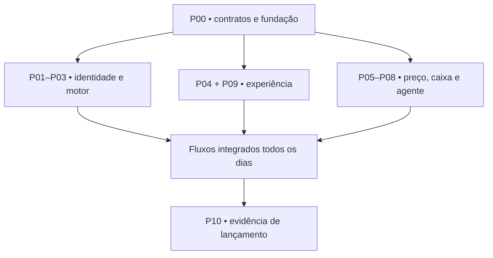

# 07 · Fases, pacotes e cronograma

O mapa completo está em `docs/17_MAPA_COMPLETO_DESENVOLVIMENTO.md`. São oito macrofases: F0 fundação; F1 operação; F2 serviços e integrações; F3 crescimento; F4 busca e reputação; F5 operação avançada; F6 mobile e escala; F7 formação, parceiros e equipes. Este capítulo detalha a primeira entrega. P00–P18 preservam os IDs do plano anterior.

F0/F1 têm uma meta inicial de aproximadamente sete dias, sujeita à base existente e aos critérios de aceite. F2 começa após estabilizar o piloto. As demais frentes avançam por dependências, demanda e capacidade de operação, sem promessa de data fixa. Nenhuma fase é concluída apenas por produzir telas ou linhas de código.

## P00 precede os dez pacotes

P00, conduzido por um integrador por 4–8 horas estimadas, confirma repositório, preserva ativos, cria app e contratos v1. Criar shell navegável, fixtures, base de RLS, pipeline que realmente executa testes e conexão do preview à homologação. Nenhum módulo deve escolher outra stack sozinho.

As estimativas abaixo são **horas de trabalho humano com agentes**, incluindo revisão local; não benchmarks nem garantia de throughput. Total P01–P10: 56–94 horas; P00 acrescenta 4–8; prever 20–30% para integração/retrabalho. Duas pessoas disponíveis integralmente podem tentar sete dias; se os gates falharem, reduzir escopo ou adiar, sem pular segurança.

| Pacote | Entrega | Responsável | Horas | Dependência para começar | Dependência de integração |
|---|---|---|---:|---|---|
| P01 | Identidade, tenant, acesso e onboarding técnico | A definir na reserva | 6–10 | P00 | Base de todos os módulos |
| P02 | Clientes, serviços, custos e importação mínima | A definir na reserva | 4–6 | P00 | P01 para dados reais |
| P03 | Motor de disponibilidade e reservas | A definir na reserva | 8–12 | P00 | P01 + P02 |
| P04 | Agenda visual e experiência mobile web | A definir na reserva | 6–10 | P00 | P03 |
| P05 | Regras de preço e ofertas | A definir na reserva | 5–8 | P00 | P02 + P03 |
| P06 | Lista de espera e jobs | A definir na reserva | 6–10 | P00 | P03 + P05 |
| P07 | Recebíveis, caixa e créditos de sessões | A definir na reserva | 5–8 | P00 | P01 + P03 |
| P08 | Assistente web, ferramentas e aprovações | A definir na reserva | 6–10 | P00 | P03 + P05 + P07 |
| P09 | Perfil público, cliente e convites | A definir na reserva | 4–8 | P00 | P01 + P03 |
| P10 | Integração final, isolamento, UAT e liberação | Integrador definido na reserva | 6–12 | P01–P09 integrados | Todos |

A responsabilidade é definida ao reservar a tarefa. Felipe ou Gabriel podem assumir qualquer pacote conforme disponibilidade e habilidade; uma sessão mantém a escrita da área reservada. O integrador coordena o conjunto e outro revisor confere as mudanças críticas.

## O que pode andar em paralelo

Depois do P00, frontend de P04 pode usar fixtures contratuais enquanto P03 implementa o motor. P07 pode desenvolver ledger contra eventos fixados. P09 constrói perfil sem esperar marketing. Isso autoriza desenvolvimento, **não autoriza declarar a integração funcional antes de conectar o backend real**.

No quadro, `done` significa pacote aceito em PR integrado com testes de seu escopo. Se tiver consumidor ainda com fixture, o handoff registra essa limitação e a tarefa de conexão permanece no P10/issue específica. O release só abre após os fluxos reais, sem mocks internos. Preferir PRs pequenos de contrato → implementação → conexão, em vez de um PR final por pacote de milhares de linhas.

Não abrir dez sessões no dia 1. Limite inicial recomendado: quatro implementadores, uma sessão de revisão/integração. Aumentar só se houver contratos estáveis, fila de revisão curta e conflitos raros. Uma pessoa com cinco terminais continua tendo capacidade finita para avaliar cinco entregas.

## Agenda de sete dias

| Dia | Construção | Demonstração obrigatória |
|---|---|---|
| 1 | P00; iniciar P01/P02/P04/P09 | Login/shell, tenant sintético, um serviço exibido, CI e preview |
| 2 | P01/P02 e P03; UX conectável | Dois tenants isolados; cliente e serviço persistem |
| 3 | P03/P04/P07; avançar P05 | Cliente reserva; dono conclui; registra recebido |
| 4 | P05/P06/P08 | Oferta por horário com piso; cancelamento prepara oportunidade |
| 5 | P06/P08/P09; conexões completas | Lista aceita vaga sem duplicação; agente usa dados reais |
| 6 | P10; correções; privacidade e restauração | UAT com 2–3 profissionais; suite de segurança e concorrência |
| 7 | P10 e onboarding controlado | 6–10 usuários convidados; suporte presente; métricas e rollback |

Dois checkpoints de integração de 20 minutos por dia; PRs revisados em blocos curtos. Se ao final do dia 3 não houver fluxo de reserva real, congelar voz, customização visual secundária, importação sofisticada e qualquer integração externa. Se dia 5 a lista de espera não passar concorrência, manter só uso interno assistido; não fingir que está pronta.

## Depois do piloto

Semanas 2–3: corrigir fricção, duplicidades e onboarding; integrar canal oficial em poucos negócios. Semanas 3–6: avançar para 50, monitorar custo/retensão e só então ampliar aquisição. F4: descoberta local com densidade e perfis consentidos, sem vender ranking orgânico. Mobile quando a web móvel tiver uso recorrente e limitações identificadas, não por calendário de marketing.

## Revisão de aderência ao mapa do Gabriel

Ver doc15 para as 12 ofertas e o detalhamento P11–P18 da fase 2. Fiscal seletivo pode ser experimentado em F2 após homologação; cobertura fiscal ampliada é uma extensão posterior de P16, condicionada a cada caso. P1 do catálogo não significa esta sprint. Não ampliar as estimativas P01–P10 para absorver website, orçamento comercial completo, fiscal ou suporte ilimitado. Medir baseline e minutos humanos desde P10. Oferta inicial de produto: Agenda organizada; serviços assistidos têm escopo e conta separados.
