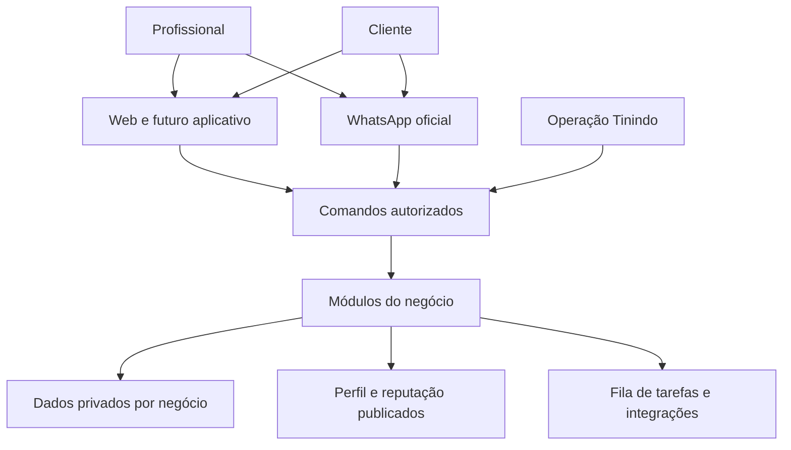
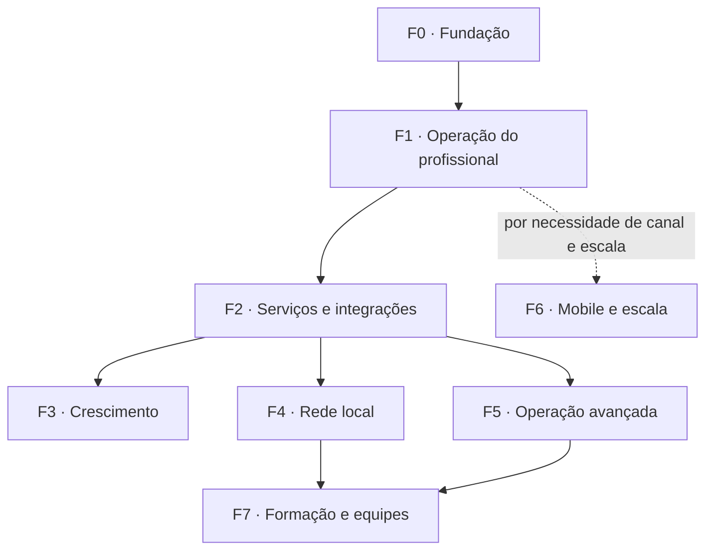
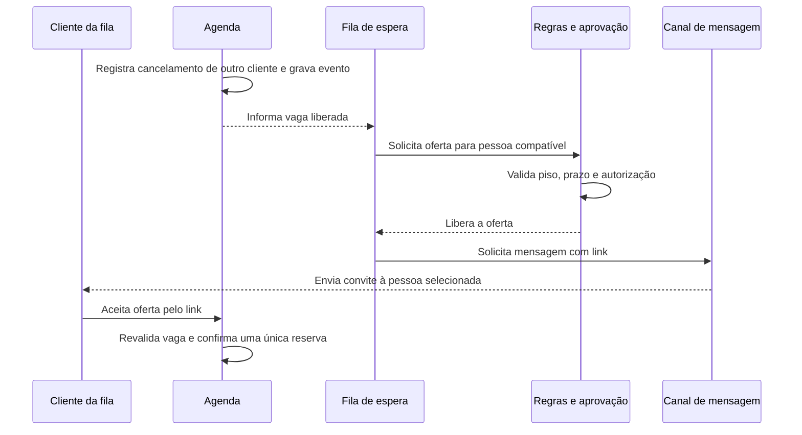
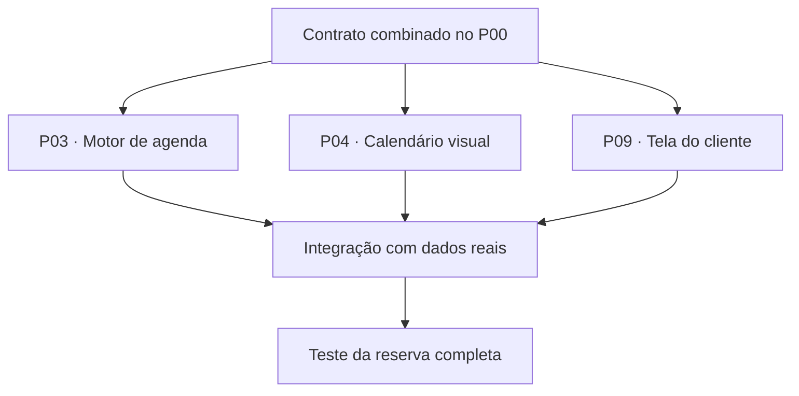
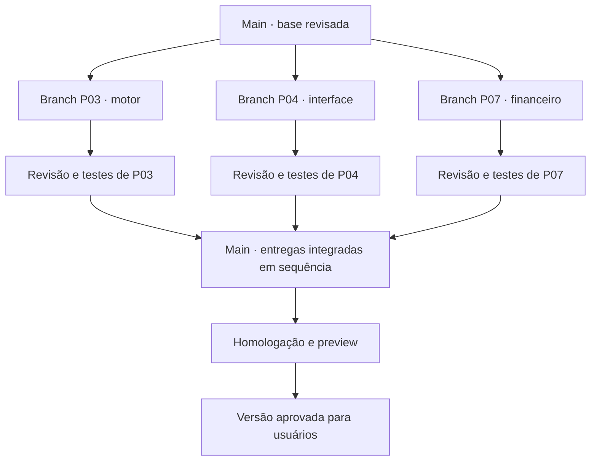

# Tinindo — mapa completo do desenvolvimento

Versão 2.0 da visão do programa · Conteúdo para decisão e apresentação dos sócios.

**8 grandes fases, incluindo a fundação; 42 pacotes identificados, P00 a P41.** Esse é o desdobramento proposto da visão atual, não uma medição definitiva de esforço. Pacotes podem ser subdivididos ao detalhar a implementação. A Tinindo começa a ser testada ao concluir F1; não precisa terminar as oito fases para vender.

O plano anterior aprofundou o piloto, mas agrupou demais o restante. Este documento apresenta primeiro o sistema inteiro e depois suas entregas. Preserva os IDs P00–P18 já especificados. Nenhuma tarefa nova foi ativada no GitHub. A apresentação aplica o brand kit v0.2 enviado nesta revisão: logotipo original, tokens oficiais, Inter e Inter Display.

## 1. O sistema completo

A Tinindo terá quatro experiências conectadas: o profissional organiza e opera seu negócio; o cliente reserva e contrata; a equipe Tinindo entrega serviços assistidos e resolve exceções; parceiros entram em serviços especializados quando houver contrato e permissão. Web, WhatsApp e aplicativo móvel são canais de acesso às mesmas regras.

A equipe de suporte não ganha acesso irrestrito por usar um painel interno. Os dados públicos são uma seleção autorizada, não uma cópia do cadastro privado.

## 2. Vocabulário para os sócios

| Termo | Significado na Tinindo | Exemplo |
|---|---|---|
| Fase | Conjunto de capacidades que muda o que a empresa consegue entregar | F4 torna a Tinindo um lugar para encontrar profissionais |
| Pacote | Entrega delimitada com entrada, saída e teste de aceite | P24 cria avaliações, denúncias e evidências |
| Módulo | Parte permanente do sistema, com responsabilidade própria | Agenda continua existindo e evoluindo em várias fases |
| Tarefa | Um trabalho menor dentro do pacote | Validar o vencimento de um convite |
| Branch | Linha temporária de alterações no código | Implementar P24 sem editar diretamente a versão integrada |
| Worktree | Pasta local exclusiva de uma sessão | Duas sessões no mesmo computador usam pastas diferentes |
| Contrato entre módulos | Formato combinado para pedir e devolver informação | Pedir reserva com cliente, serviço, horário e preço |
| PR | Pedido de revisão e integração das alterações | Outro revisor confere P24 antes do merge |
| Main | Versão que reúne o trabalho revisado | Fonte do ambiente compartilhado de homologação |
| Release | Versão aprovada para os usuários reais | Um conjunto testado de mudanças, identificado por commit/tag |

Um pacote pode exigir várias branches curtas, uma após a outra. Uma branch não é um aplicativo separado nem um servidor que precisa continuar ligado. Depois de integrar, seu código passa a fazer parte do produto comum.

## 3. Visão das oito fases

| Fase | Pacotes | Quantidade | Resultado para o negócio | Condição de saída |
|---|---|---:|---|---|
| F0 · Fundação compartilhada | P00 | 1 | Base única para todas as sessões | Um app mínimo executa com login, banco isolado e verificação automática. |
| F1 · Operação do profissional | P01–P10 | 10 | Primeiro negócio operando de ponta a ponta | Beleza e personal completam reserva, atendimento, fila e registro financeiro com dados reais autorizados. |
| F2 · Serviços digitais e integrações | P11–P18 | 8 | Tinindo executa trabalho e cobra por escopo | Canal oficial, recebimento e serviço assistido funcionam nos casos homologados. |
| F3 · Crescimento e recorrência | P19–P22 | 4 | Mais retornos e melhor uso da capacidade | Campanhas e programas mostram resultado medido sem destruir margem ou consentimento. |
| F4 · Busca, indicação e reputação | P23–P27 | 5 | Cliente encontra e contrata profissionais | Uma comunidade tem oferta ativa, avaliações legítimas e atendimento dos pedidos. |
| F5 · Operação avançada | P28–P33 | 6 | Atender negócios mais complexos | Cada expansão mantém consistência de agenda, custos, caixa e autorizações. |
| F6 · Aplicativo móvel e escala | P34–P37 | 4 | Expandir canais e capacidade com controle | Aplicativo móvel e plataforma passam seus critérios próprios de segurança, carga e recuperação. |
| F7 · Formação, parceiros e equipes | P38–P41 | 4 | Ecossistema além do software | Novas operações têm contratos, evidências de competência e economia própria. |

As fases expressam capacidades, não oito filas obrigatórias. F3, F4 e partes de F5/F6 podem avançar em paralelo após suas dependências. Já formação e equipes próprias precisam de decisões de negócio adicionais. A segurança começa em F0 e acompanha todas as entregas; F6 amplia escala e maturidade.

As setas resumem o programa. A tabela de pacotes abaixo define dependências precisas. F4 exige oferta local e moderação antes de abrir ao público; isso não é uma dependência resolvida apenas por código.

## 4. Pacotes de cada fase

Todos os responsáveis estão **a definir no momento da reserva da tarefa**. Os pacotes não pertencem permanentemente a Felipe ou Gabriel. Quem implementa precisa de uma área exclusiva; quem integra avalia o conjunto.

A coluna “depende” significa dependência para integração real. Interfaces e testes podem começar antes, usando exemplos combinados, desde que isso fique identificado. Simulação não é evidência de funcionalidade concluída.

### F0 · Fundação compartilhada

Resultado: Base única para todas as sessões. Dia 1 como meta inicial.

| Pacote | Entrega concreta | Parte da arquitetura | Depende para integrar | Aceite resumido |
|---|---|---|---|---|
| P00 · Fundação | Repositório canônico, padrões de interface, autenticação-base, ambientes, contratos e coordenação. | Base compartilhada | — | App mínimo executa; cada sessão sabe sua área; banco e segredos de teste separados de produção. |

**Paralelismo nesta fase:** O integrador organiza P00 antes de liberar implementações. Os dois sócios podem levantar requisitos e testar fluxos, mas contratos, configuração do projeto e banco têm um único responsável de escrita.

### F1 · Operação do profissional

Resultado: Primeiro negócio operando de ponta a ponta. Piloto ao redor do dia 7, condicionado aos testes.

| Pacote | Entrega concreta | Parte da arquitetura | Depende para integrar | Aceite resumido |
|---|---|---|---|---|
| P01 · Conta e negócio | Cadastro, organização, permissões e onboarding por profissão. | Identidade | P00 | Usuário de um negócio não acessa dados privados de outro. |
| P02 · Clientes e serviços | Clientes, origem, serviços, duração, preço-base, custos e importação CSV. | CRM e catálogo | P01 | Importação tem prévia, erros visíveis e tratamento de duplicidades. |
| P03 · Motor de agenda | Horários livres, reservas, cancelamento e remarcação com regras únicas. | Disponibilidade e reservas | P01,P02 | Duas pessoas disputam o mesmo horário e só uma confirma. |
| P04 · Agenda visual | Calendário móvel, dia/semana, detalhes e ocupação. | Interface de agenda | P03 | Tudo que aparece na tela corresponde ao estado real do motor. |
| P05 · Preço e ofertas | Preço por faixa de horário, piso, desconto máximo e cotação válida. | Precificação | P02,P03 | Preço aprovado fica congelado; oferta nunca ultrapassa limites definidos. |
| P06 · Lista de espera | Compatibilidade, sequência de oferta, prazo e aceite de vaga. | Fila e tarefas programadas | P03,P05 | Uma vaga não é prometida a duas pessoas; repetição não duplica reserva. |
| P07 · Caixa e sessões | Recebíveis, recebimentos manuais identificados e créditos de pacotes. | Financeiro básico | P01,P03 | Pacote recebido entra uma vez no caixa; sessão consumida só reduz crédito. |
| P08 · Assistente do dono | Perguntas sobre dados reais e preparação de ações com aprovação. | Agente e aprovações | P03,P05,P07 | O agente não inventa saldo nem executa desconto sem autorização válida. |
| P09 · Perfil e acesso do cliente | Perfil compartilhável, reserva do cliente e convites separados de avaliações. | Publicação e portal | P01,P03 | Cliente vê sua própria reserva; convite não publica telefone nem cria nota. |
| P10 · Aceite do piloto | Jornadas reais, testes de isolamento, recuperação e operação assistida. | Qualidade e liberação | P01–P09 | Piloto funciona sem dados fictícios ocultos no caminho principal. |

**Paralelismo nesta fase:** Depois dos contratos de P00, P02, a interface P04, o financeiro P07 e o perfil P09 podem avançar em áreas separadas. O motor P03 precisa de identidade e serviços reais para ser validado. P05 e P06 dependem dele. P10 verifica o conjunto, mas a integração ocorre todos os dias.

### F2 · Serviços digitais e integrações

Resultado: Tinindo executa trabalho e cobra por escopo. Após o piloto; entregar subconjuntos.

| Pacote | Entrega concreta | Parte da arquitetura | Depende para integrar | Aceite resumido |
|---|---|---|---|---|
| P11 · Orçamentos e aceite | Proposta comercial versionada, validade, aprovação do cliente e vínculo à reserva. | Vendas | P01,P02,P05,P09 | Aceite repetido não duplica; confirmar orçamento não cria horário inexistente. |
| P12 · WhatsApp oficial | Conexão autorizada, entrada/saída, estado de mensagens e transferência para humano. | Canais | P01,P06,P08 | Identidade e webhooks validados; enviado, entregue e falhou são estados distintos. |
| P13 · Lembretes e acompanhamento | Confirmação, lembretes, follow-up, retorno e reativação básicos. | Relacionamento | P11,P12,P06 | Régua para quando ocorre aceite, cancelamento, pagamento ou oposição aplicável. |
| P14 · Pagamento conectado | Cobrança via parceiro, confirmação, estorno e reconciliação de eventos. | Pagamentos | P01,P07 | Uma notificação repetida não dá baixa duas vezes; falha incerta exige consulta. |
| P15 · Planos e serviços assistidos | Assinatura, franquias, pedidos de implantação, responsáveis, horas e entregáveis. | Operação Tinindo | P01,P07,P08 | Escopo e aprovação registrados; limite aplicado no servidor; suporte com acesso autorizado. |
| P16 · Fiscal seletivo | Emissão em um caso elegível, documentos e pasta para contador. | Fiscal | P02,P07,P15 | Homologação, representação e credencial válidas; emitir nota não confirma pagamento. |
| P17 · Site e Google | Página padronizada, domínio, publicação aprovada e operação Google com acesso delegado. | Presença digital | P09,P15 | Cliente controla seus ativos; entrega tem evidência; nenhuma garantia de posição. |
| P18 · Resultado e custo | Baseline, ocupação, faltas, horas humanas e custos por cliente. | Métricas | P03,P07,P13,P15 | Indicadores mostram período, denominador e dados ausentes. |

**Paralelismo nesta fase:** Orçamentos P11 e canal P12 podem avançar em paralelo; pagamentos P14 e operação Tinindo P15 também, com fronteiras fixadas. P13 conecta eventos comerciais ao canal. P16/P17 usam o registro de entregas de P15. Não abrir todos os pacotes sem capacidade de revisão.

### F3 · Crescimento e recorrência

Resultado: Mais retornos e melhor uso da capacidade. Após histórico operacional suficiente.

| Pacote | Entrega concreta | Parte da arquitetura | Depende para integrar | Aceite resumido |
|---|---|---|---|---|
| P19 · Campanhas e experimentos | Segmentos, orçamento de envio, ofertas e comparação de intervenções. | Crescimento | P13,P18 | Autorização do público, limite de gasto e avaliação de resultado sem causalidade presumida. |
| P20 · Planos recorrentes do profissional | Assinaturas de serviços, renovação, fidelidade e pacotes configuráveis. | Recorrência comercial | P07,P11,P14 | Cancelamento/renovação preservam regras aceitas e saldo de sessões. |
| P21 · Indicação de colegas | Convites rastreados e eventual benefício por adesão elegível. | Aquisição | P09,P15,P18 | Benefício não compra avaliação nem nota; duplicidade/autoindicação tratadas. |
| P22 · Metas e conteúdo | Metas, rotina de sugestões, conteúdo aprovado e aprendizado por resultado. | Orientação e marketing | P15,P18,P19 | Recomendação se apoia em dado existente; publicação passa pelo escopo autorizado. |

**Paralelismo nesta fase:** P19, P20 e P21 têm entregas distintas e podem avançar juntos quando suas dependências estiverem integradas. P22 utiliza os resultados e a infraestrutura de campanhas; publicação externa permanece controlada.

### F4 · Busca, indicação e reputação

Resultado: Cliente encontra e contrata profissionais. Após densidade local; pode avançar junto de F3.

| Pacote | Entrega concreta | Parte da arquitetura | Depende para integrar | Aceite resumido |
|---|---|---|---|---|
| P23 · Diretório e busca local | Busca por profissão, região, disponibilidade publicável e páginas indexáveis. | Descoberta | P09,P17 | Só dados autorizados aparecem; resultados refletem critérios documentados. |
| P24 · Avaliações e verificação | Experiências, vínculo quando verificável, resposta, denúncia e verificação de escopo. | Reputação | P09,P03 | Indicação informal, identidade verificada e competência certificada não se confundem. |
| P25 · Solicitação e contratação | Pedido do cliente, profissionais compatíveis, propostas e contratação rastreável. | Marketplace | P11,P14,P23 | Preço, disponibilidade e responsabilidade claros antes de confirmar. |
| P26 · Condomínios e comunidades | Comunidades, convites e acesso local sem divulgar pedidos privados. | Distribuição local | P09,P23,P24 | Morador e administrador têm permissões distintas; endereços protegidos. |
| P27 · Ranking e operação da rede | Ordenação explicável, moderação, antifraude e testes de monetização. | Confiança e monetização | P18,P23,P24,P25 | Destaque pago identificado; nota orgânica não comprável; contestação disponível. |

**Paralelismo nesta fase:** P23 busca e P24 reputação podem avançar em paralelo. P25 contratação conecta busca a orçamento/pagamento. P26 comunidade reutiliza perfil e reputação. P27 integra moderação e ranking antes do lançamento público.

### F5 · Operação avançada

Resultado: Atender negócios mais complexos. Por demanda de segmentos escolhidos.

| Pacote | Entrega concreta | Parte da arquitetura | Depende para integrar | Aceite resumido |
|---|---|---|---|---|
| P28 · Equipes e recursos | Vários profissionais, salas, cadeiras, turmas e comissões. | Agenda avançada | P03,P07,P15 | Reserva composta não deixa recursos parcialmente comprometidos. |
| P29 · Serviço a domicílio | Área, deslocamento, janela de chegada, rota e execução da visita. | Operação externa | P03,P11,P25 | Viagem entra na disponibilidade; localização tem finalidade e precisão limitadas. |
| P30 · Materiais e custos | Peças/consumíveis, compras, uso por serviço e margem real. | Materiais de serviço | P02,P07,P11 | Consumo e estorno não duplicam estoque; conta não depende de texto livre do agente. |
| P31 · Financeiro ampliado | Contas a pagar, categorias, conciliação por parceiro e demonstrativo gerencial. | Gestão financeira | P07,P14,P16 | Cobertura e reconhecimento definidos antes de chamar relatório de DRE. |
| P32 · Previsão e otimização | Demanda, cancelamento, teste de preço e sugestões de capacidade. | Inteligência de capacidade | P05,P18,P19 | Modelo supera baseline em teste temporal; limites determinísticos permanecem. |
| P33 · Projetos e novas configurações | Ordens de serviço, etapas, materiais e perfis configuráveis para novos serviços. | Operações verticais | P11,P15,P28,P30 | Configuração muda fluxo sem criar ERP independente nem violar dados entre negócios. |

**Paralelismo nesta fase:** P28, P29, P30 e P31 podem evoluir em frentes distintas, mas alterações em reservas e financeiro exigem integração coordenada. P32 precisa de dados e experimento, não apenas programação. P33 combina capacidades para um novo segmento escolhido.

### F6 · Aplicativo móvel e escala

Resultado: Expandir canais e capacidade com controle. Quando uso e limites justificarem.

| Pacote | Entrega concreta | Parte da arquitetura | Depende para integrar | Aceite resumido |
|---|---|---|---|---|
| P34 · Aplicativo móvel | iPhone e posterior expansão móvel usando os mesmos comandos e banco. | Canal mobile | P10 e contratos dos módulos expostos | Reserva offline não aparece confirmada; sessão e notificações protegidas. |
| P35 · Calendários e conectores | Calendário externo e conectores priorizados com contratos estáveis. | Integrações adicionais | P03,P12,P15 | Conflito, exclusão, expiração de acesso e loop de sincronização tratados. |
| P36 · Capacidade e recuperação | Testes maiores de carga, recuperação, monitoramento e otimização de custo. | Plataforma | P10,P18 | Metas medidas e plano de recuperação ensaiado; segurança já existia desde F0. |
| P37 · Automações extensíveis | Biblioteca de fluxos, regras por negócio e novas ferramentas autorizadas. | Plataforma de agentes | P08,P13,P15,P18 | Fluxo versionado, limitado por orçamento/permissão e interrompível. |

**Paralelismo nesta fase:** Mobile P34 pode avançar com APIs estáveis sem esperar a escola ou todas as verticais. P35 trabalha conectores. P36 mede capacidade. P37 amplia automações. Mudanças de contrato e implantação continuam serializadas.

### F7 · Formação, parceiros e equipes

Resultado: Ecossistema além do software. Condicional; novas decisões de negócio.

| Pacote | Entrega concreta | Parte da arquitetura | Depende para integrar | Aceite resumido |
|---|---|---|---|---|
| P38 · Formação por parceiros | Cursos, matrícula, conclusão e conexão com a profissão. | Educação | P15,P23 | Conclusão distingue participação de competência comprovada. |
| P39 · Certificação | Critérios, avaliador, escopo, evidência, validade e revogação. | Credenciais profissionais | P24,P38 | Selo informa exatamente o que foi verificado; regras profissionais específicas respeitadas. |
| P40 · Benefícios e parceiros | Encaminhamento a fornecedores, contabilidade, seguros e serviços especializados. | Ecossistema comercial | P15,P18,P27 | Responsabilidade e remuneração transparentes; parceiro habilitado quando necessário. |
| P41 · Equipes próprias | Escala, qualidade, retrabalho, materiais e resultado da operação própria. | Operação de campo Tinindo | P15,P25,P28,P29,P30,P39 | Contratos, responsabilidade e economia separados do software; piloto operacional aprovado. |

**Paralelismo nesta fase:** P38 educação e P40 parcerias podem ser explorados separadamente. P39 exige critérios e evidência de avaliação. P41 depende da cadeia operacional e de uma decisão empresarial; não se resolve abrindo mais sessões de código.

## 5. Arquitetura explicada sem pressupor conhecimento técnico

**Decisão: um sistema modular, com regras compartilhadas e dados protegidos por negócio.** O nome técnico é monólito modular. A agenda, o financeiro e a reputação têm fronteiras claras, mas fazem parte do mesmo produto e usam um processo de implantação coordenado.

Isso permite dividir o código entre sessões sem obrigar dois fundadores a operar dezenas de sistemas independentes. A separação lógica facilita a construção; não exige microsserviços, bancos por módulo ou infraestrutura exclusiva para cada pacote.

| Camada | O que faz | Escolha proposta | Por que existe |
|---|---|---|---|
| Interface | Mostra agenda, aprovações e dados | React + TypeScript, web primeiro | Uma experiência acessível no computador e celular |
| Agente | Entende o pedido e seleciona uma ferramenta permitida | LLM com ferramentas específicas | O profissional fala em linguagem natural |
| Regras | Valida horário, preço, direito de acesso e pagamento | Comandos e cálculos determinísticos | O resultado precisa ser correto, mesmo se a IA interpretar mal |
| Banco | Guarda clientes, reservas e registros financeiros | PostgreSQL com Supabase como serviço gerenciado | Relações e transações dão consistência ao negócio |
| Fila | Executa tarefas que podem esperar ou precisar de nova tentativa | Eventos persistidos e jobs | Uma queda não deve apagar o lembrete ou duplicar uma cobrança |
| Adaptadores | Conversa com WhatsApp, pagamentos, fiscal e Google | Conectores separados do domínio | Mudança de fornecedor não reescreve a agenda |
| Controle | Limita acesso e registra ações | Permissões, aprovação e auditoria | Cada pessoa e agente só pode fazer o que foi autorizado |

A escolha da stack continua sujeita à inspeção do código existente. Se já houver backend funcional, P00 avalia reaproveitamento antes de trocar. Branch de código não isola banco: cada ambiente precisa de sua configuração e dados de teste.

### Um caso concreto: recuperar horário cancelado

O convite vai para uma pessoa compatível da fila. O cancelamento veio de outro atendimento. Em F1 o envio pode ser manual e identificado. F2 conecta o canal oficial. A mesma regra de reserva vale nos dois casos.

**O agente não precisa participar de toda etapa.** Se uma regra já foi aprovada e pode ser executada com segurança, o sistema executa a regra e registra o resultado. A IA ajuda a interpretar, explicar e propor.

## 6. Por que os pacotes podem avançar em paralelo

Três condições tornam o paralelismo viável: contratos definidos, arquivos de trabalho separados e dependências conhecidas. Ter branches diferentes, sozinho, não resolve divergência de significado.

Exemplo de contrato: P03 disponibiliza `buscarHorarios` e `confirmarReserva`. P04 desenha a agenda consumindo esse contrato. P09 faz a tela do cliente usando as mesmas operações. P05 fornece `calcularOferta`. Cada equipe sabe os campos, os erros e os resultados esperados antes de terminar o outro pacote.

P04 e P09 podem usar horários sintéticos para construir a interface enquanto P03 fica pronto. Nenhum dos dois passa no aceite final sem conectar o motor real. Alterar campo compartilhado exige atualizar o contrato primeiro e adaptar os consumidores.

| Pode avançar separado | Precisa de coordenação |
|---|---|
| Tela de clientes e tela de agenda | Nome e significado do cliente no contrato |
| Regra de preço e layout da oferta | Fórmula e versão da cotação usada na confirmação |
| Conector de pagamento e painel financeiro | Evento que reconhece pagamento e estorno |
| Busca pública e CRM privado | Quais dados podem ser publicados |
| Dois testes de módulo | Alterações no banco compartilhado |

## 7. Branches, revisão e integração

**Uma sessão, uma área delimitada e uma branch.** Se um pacote grande tiver duas sessões simultâneas, primeiro dividir em tarefas com arquivos próprios e contratos definidos. Não dar o mesmo pacote a duas sessões e confiar que resolverão depois.

Os merges acontecem um por vez sobre a versão mais recente. Um PR que passou antes pode precisar de novo teste após outro merge. As setas não autorizam juntar três mudanças ao mesmo tempo sem conferir o resultado.

### Exemplo de um dia de trabalho

1. Uma sessão consulta o quadro remoto, reserva P03 e abre sua pasta/branch.
2. Outra reserva P04 e trabalha na interface usando o contrato de P03.
3. Outra pode trabalhar em P07, se houver disponibilidade de revisão. O responsável pode ser qualquer sócio.
4. P03 entrega um recorte pequeno: consultar e reservar um horário. O integrador revisa e junta à main.
5. P04 atualiza sua base e troca o exemplo sintético pela agenda real.
6. O conjunto é testado no ambiente compartilhado; defeitos viram tarefas delimitadas.
7. A produção só recebe a versão que cumpriu os critérios de liberação.

Não acumular branches por uma fase inteira para descobrir no final se os módulos combinam. O pacote de integração final verifica o conjunto já conectado.

### O que o coordenador resolve e o que não resolve

O quadro remoto registra responsável, sessão, área, dependências e PR. CLAUDE.md/AGENTS.md explicam o protocolo. Proteção de branches, revisão e verificações automáticas são controles adicionais. O arquivo de instruções não impede fisicamente uma sessão de editar a área errada.

O coordenador entregue trabalha com ondas de tarefas e exige concluir a onda ativa antes de avançar. **Macrofase do produto e onda de implementação são conceitos diferentes.** Uma onda futura pode selecionar pacotes de F3 e F4 cujas dependências já estejam prontas. P00–P10 continuam a primeira onda. P11–P41 não entram no quadro só por existir neste documento.

O suporte atual de tarefas é P00–P99, suficiente para este mapa. Se um pacote precisar de trabalho simultâneo, o integrador registra novas tarefas com IDs próprios e vínculos ao pacote, sem reutilizar IDs nem alterar o quadro à mão. O mapa de 42 pacotes é desdobramento do programa, não licença para abrir 42 sessões.

## 8. Onde entram as 228 oportunidades do Gabriel

O catálogo descreve ofertas possíveis. Algumas viram funcionalidade; outras são uma combinação de módulos existentes; outras exigem gente ou parceiros. Um item do catálogo não equivale a um pacote de desenvolvimento.

| Área do catálogo | Base de arquitetura | Destino no programa |
|---|---|---|
| Fiscal e tributário | Documentos, permissões e parceiro | P16 e P40; cobertura ampliada por caso validado |
| Financeiro e cobrança | Recebíveis, pagamento e classificação | P07,P14,P31 |
| Parcerias financeiras e benefícios | Catálogo de parceiros e encaminhamento | P40; não vira banco próprio |
| Agenda e atendimento | Reserva, canal e regras | P03,P04,P06,P12,P13,P28,P29 |
| Marketing e presença digital | Perfil, publicação e campanhas | P17,P19,P22 |
| Vendas e canais | Clientes, orçamento e contratação | P02,P11,P25 |
| Jurídico e conformidade | Evidência, documentos e parceiro | Controles desde F0; serviços profissionais via P15/P40 |
| Formalização | Pedido assistido e encaminhamento | P15/P40; sem automatizar parecer profissional |
| Pessoas e equipe | Recursos, escala e operação | P28/P41; RH amplo permanece oportunidade não aprovada |
| Operações e processos | Execução, checklist e fluxo | P15,P29,P33,P37 |
| Compras, estoque e logística | Materiais e deslocamento | P29/P30; comércio físico completo fora do eixo atual |
| Precificação e ofertas | Cálculo, regras e experimento | P05,P19,P20,P32 |
| Administração e documentos | Entregas, arquivos e assinatura por parceiro | P11,P15,P16,P35 |
| Tecnologia e segurança | Controles próprios e serviços assistidos | F0 em diante; serviços ao cliente por P15/P17/P40 |
| Estratégia, consultoria e educação | Metas, operação assistida e formação | P18,P22,P38/P40 |
| Dados, IA e automação | Eventos, agente e analytics | P08,P18,P32,P37 |
| Verticais por setor | Configuração do núcleo e extensões delimitadas | P28–P33; novos setores exigem decisão própria |

Este mapa cobre a visão completa do **ecossistema de serviços**. Não aprova construir ERP industrial, e-commerce, sistema clínico ou as 33 verticais do catálogo de uma vez. O anexo dos 228 itens anterior continua sendo o inventário de oportunidades; as fases antigas ali devem ser lidas com a correspondência abaixo.

## 9. Correspondência com o plano anterior

| Plano anterior | Mapa atual |
|---|---|
| F0 fundação / P00 | F0 / P00, preservado |
| F1 piloto / P01–P10 | F1 / P01–P10, preservados |
| F2 operação assistida / P11–P18 | F2 / P11–P18, preservados |
| Crescimento disperso em módulos | F3 / P19–P22, explicitado |
| F3 rede local | F4 / P23–P27 |
| F4 sofisticação e mobile | F5 operação avançada + F6 mobile/escala |
| F5 ecossistema | F7 / P38–P41 |

A mudança é de clareza e decomposição. Não renomear branches ou tarefas ativas por causa de uma nova numeração de macrofases. O kit entregue incorpora este mapa. No repositório remoto, a adoção ocorre por PR, preservando eventuais tarefas em andamento.

## 10. Estrutura da apresentação visual aos sócios

O brand kit v0.2 define logotipo, cores, fontes, proporções, grafismos e restrições. Não reinterpretar a marca com base apenas na lembrança do site. Usar diagramas e quadros legíveis; efeitos decorativos não substituem dependências ou conteúdo.

| Slide | Conteúdo | Visual principal |
|---|---|---|
| 1 | O sistema inteiro; a construção por partes | Capa e escopo |
| 2 | Quem usa e quem opera | Experiências sobre o mesmo núcleo |
| 3 | O mapa completo | Oito fases e quantidade de pacotes |
| 4 | Fase, pacote, módulo e branch | Vocabulário com exemplos |
| 5 | Arquitetura por trás do produto | Canais, comandos e módulos |
| 6 | F0 · Fundação compartilhada | Base comum e motivos |
| 7 | F1 · Dados e agenda | P01–P05 |
| 8 | F1 · Rotina completa | P06–P10 |
| 9 | O paralelo dentro do piloto | Contratos, frentes e integração |
| 10 | F2 · Contratar, conversar e receber | P11–P14 |
| 11 | F2 · Entregar os serviços da Tinindo | P15–P18 |
| 12 | F3 · Crescimento e recorrência | P19–P22 |
| 13 | F4 · Busca, indicação e reputação | P23–P27 |
| 14 | F5 · Equipes, campo e materiais | P28–P30 |
| 15 | F5 · Gestão e otimização avançadas | P31–P33 |
| 16 | F6 · Aplicativo móvel e escala | P34–P37 |
| 17 | F7 · Formação, parceiros e equipes | P38–P41 |
| 18 | As fases não formam uma fila única | Dependências entre frentes |
| 19 | Uma vaga cancelada atravessa o sistema | Fluxo da agenda ao aceite |
| 20 | Branches separam as alterações | Revisão e integração na main |
| 21 | O que permite trabalhar em paralelo | Áreas próprias e coordenação |
| 22 | Um dia de construção | Reserva, construção, revisão e integração |
| 23 | Quando uma entrega está pronta | Perguntas e evidências de aceite |
| 24 | 228 oportunidades sobre uma base comum | Ofertas e capacidades reutilizadas |
| 25 | O primeiro ciclo de execução | P00 seguido de P01–P10 |

A apresentação tem 25 slides. F1, F2 e F5 foram divididas para preservar a legibilidade. Tabelas e diagramas são editáveis no PowerPoint; o PDF permite compartilhar a leitura com a aparência preservada.

## 11. Estado desta revisão

Concluído: visão completa, oito fases, 42 pacotes, arquitetura, dependências, paralelismo, integração, correspondência com o plano anterior e roteiro visual.

Apresentação refeita com o brand kit v0.2 recebido, em PowerPoint editável e PDF. O kit técnico incorpora este mapa e os briefings dos pacotes futuros. Nenhuma alteração de código do aplicativo, ambiente ou repositório remoto foi executada.

Base: Plano Mestre Tinindo versão 1.1, lido nesta revisão, e os mapas de Gabriel já reconciliados. Escolhas e decomposições são decisões de planejamento, não funcionalidades implementadas. Tarifas e regras de provedores permanecem sujeitas à validação no pacote correspondente.
